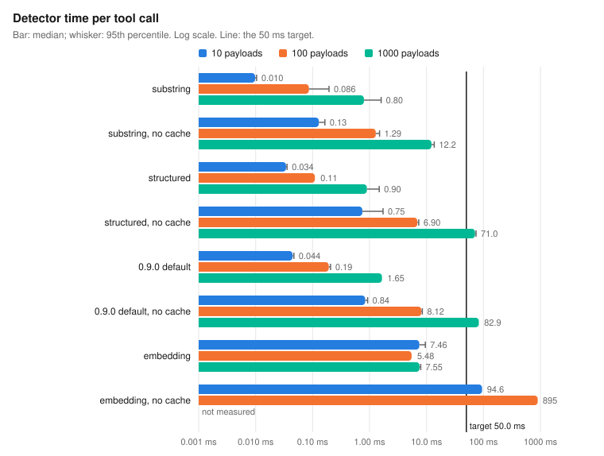
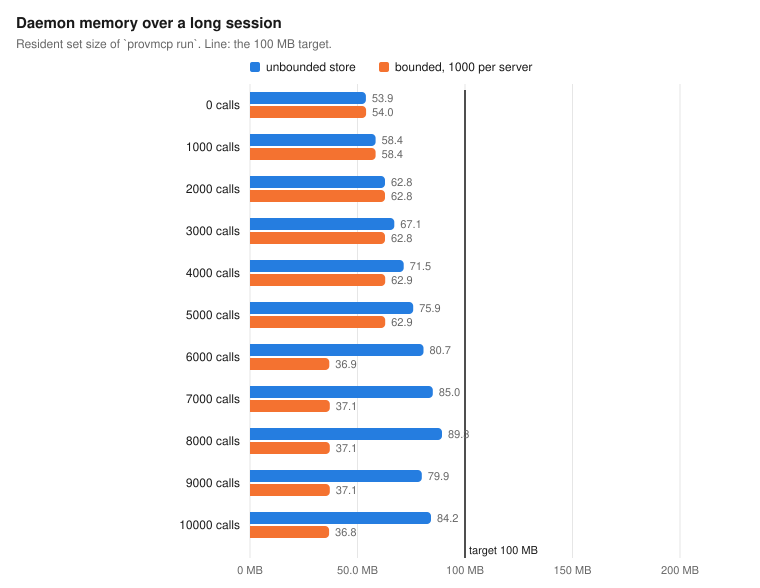

# Week 11 performance

- **date:** 2026-11-27
- **provmcp:** 0.11.0
- **machine:** Darwin arm64, Python 3.11.18
- **mode:** full
- **targets:** under 50 ms added per tool call; under 100 MB
- Workload: ~1 KB tool results with an email, URL, path and ID each; outbound calls that match nothing, so every call is fully inspected and none is held.

## 1. Detector cost per call

Time for one `scan` of an outbound call against a provenance store of N payloads, in ms. *Cached* is the 0.11 store (per-payload work done once); *no cache* is the behaviour up to 0.10.

| detector | cache | store size | p50 | p95 | p99 | first call |
|---|---|---|---|---|---|---|
| substring | yes | 10 | 0.010 | 0.010 | 0.011 | 0.2 |
| substring | yes | 100 | 0.086 | 0.195 | 0.214 | 1.4 |
| substring | yes | 1000 | 0.797 | 1.599 | 2.007 | 17.9 |
| substring | no | 10 | 0.129 | 0.165 | 0.247 | 0.1 |
| substring | no | 100 | 1.286 | 1.498 | 1.847 | 1.4 |
| substring | no | 1000 | 12.201 | 13.667 | 17.936 | 12.3 |
| structured | yes | 10 | 0.034 | 0.036 | 0.045 | 0.8 |
| structured | yes | 100 | 0.110 | 0.113 | 0.127 | 7.1 |
| structured | yes | 1000 | 0.897 | 1.478 | 4.685 | 78.5 |
| structured | no | 10 | 0.748 | 1.724 | 6.132 | 4.9 |
| structured | no | 100 | 6.897 | 7.306 | 7.459 | 7.2 |
| structured | no | 1000 | 70.969 | 74.067 | 91.904 | 73.4 |
| 0.9.0 default | yes | 10 | 0.044 | 0.047 | 0.058 | 0.9 |
| 0.9.0 default | yes | 100 | 0.193 | 0.206 | 0.224 | 8.5 |
| 0.9.0 default | yes | 1000 | 1.651 | 1.695 | 1.711 | 84.7 |
| 0.9.0 default | no | 10 | 0.837 | 0.925 | 1.017 | 0.9 |
| 0.9.0 default | no | 100 | 8.120 | 8.444 | 8.589 | 8.8 |
| 0.9.0 default | no | 1000 | 82.898 | 84.664 | 87.023 | 83.1 |
| embedding | yes | 10 | 7.461 | 9.535 | 13.910 | 5399.9 |
| embedding | yes | 100 | 5.476 | 5.651 | 5.704 | 893.2 |
| embedding | yes | 1000 | 7.546 | 7.907 | 8.685 | 8986.6 |
| embedding | no | 10 | 94.567 | 95.060 | 95.205 | 95.7 |
| embedding | no | 100 | 895.194 | 904.196 | 915.244 | 894.2 |

0.9.0 default, cached, worst p95 over all store sizes: 1.70 ms: **meets target**.

## 2. Added latency through the proxy (stdio, in-process)

| path | p50 ms | p95 ms | p99 ms |
|---|---|---|---|
| straight to the server | 0.053 | 0.067 | 0.083 |
| through ProvMCP (0.9.0 default detection) | 0.482 | 0.698 | 0.716 |

Added by ProvMCP: 0.429 ms at p50, 0.631 ms at p95, with 500 payloads stored by the end: **meets target**.

## 3. Daemon over HTTP (`provmcp run`, real loopback requests)

| detection | calls | sequential p50 / p95 ms | 8 concurrent p50 / p95 ms | throughput | RSS idle / after |
|---|---|---|---|---|---|
| 0.9.0 default | 500 | 0.99 / 2.33 | 6.57 / 8.15 | 1174.6 calls/s | 54.0 / 51.4 MB |
| default + embedding | 100 | 12.34 / 14.60 | 95.20 / 96.85 | 84.3 calls/s | 54.0 / 463.9 MB |

### Memory over a long session (10000 calls, ~1 KB results)

| calls | unbounded store: RSS MB (payloads) | bounded (1000 per server): RSS MB (payloads) |
|---|---|---|
| 0 | 53.9 (-) | 54.0 (-) |
| 1000 | 58.4 (1000) | 58.4 (1000) |
| 2000 | 62.8 (2000) | 62.8 (2000) |
| 3000 | 67.1 (3000) | 62.8 (2000) |
| 4000 | 71.5 (4000) | 62.9 (2000) |
| 5000 | 75.9 (5000) | 62.9 (2000) |
| 6000 | 80.7 (6000) | 36.9 (2000) |
| 7000 | 85.0 (7000) | 37.1 (2000) |
| 8000 | 89.3 (8000) | 37.1 (2000) |
| 9000 | 79.9 (9000) | 37.1 (2000) |
| 10000 | 84.2 (10000) | 36.8 (2000) |

After 10000 calls: unbounded 84.2 MB (**meets target**); bounded 36.8 MB (**meets target**).

## 4. The embedding model on its own

Measured in a fresh Python process.

| step | time | RSS after |
|---|---|---|
| start | - | 35.2 MB |
| import sentence-transformers | 3.6 s | 393.5 MB |
| load all-MiniLM-L6-v2 | 0.46 s | 362.2 MB |
| encode one sentence (p50 / p95) | 4.4 / 6.3 ms | 497.9 MB |

Memory with the model loaded: **misses target**.
