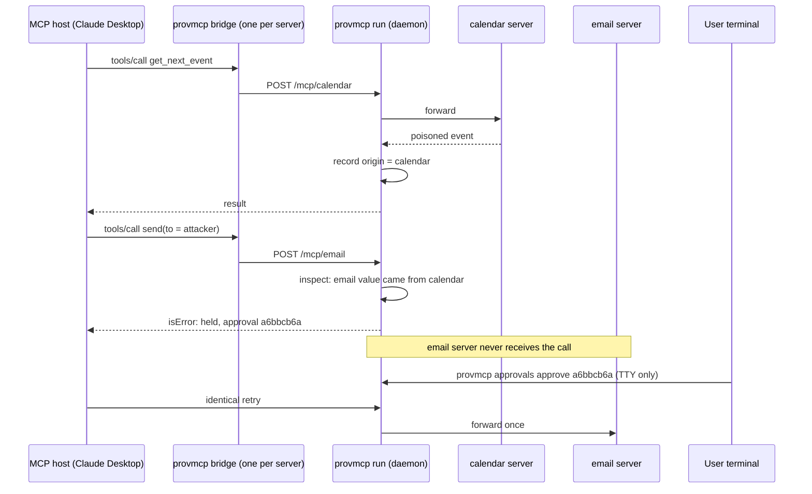

# Week 7 log — Oct 5 to Oct 9

Plan item: implement the policy engine and the three policy templates
(strict, warn-and-confirm, audit). Until now detection only ran offline over
recorded scenarios. This week it runs on live traffic and can stop a call.

## Done

- `provmcp/inspector.py` — `Inspector`. Every outbound `tools/call` is
  scanned against the shared provenance store before it is forwarded.
  Findings below `detector_threshold` are dropped. The most severe action
  across the remaining findings wins, using the policy for that
  (source, target) pair.
- Three live outcomes:
  - `strict`: the call is **blocked**. The client gets an MCP tool result
    with `isError: true` that says why; the backing server never sees it.
  - `warn_and_confirm`: the call is **held** and an approval is created.
    The tool result tells the assistant to ask the user.
  - `audit`: the call **passes** and the finding is logged.
- `provmcp/approvals.py` — out-of-band, single-use approvals. An approval
  is bound to a fingerprint of the exact call (target, tool, arguments). An
  approved call passes once; the identical retry is held again. A denied call
  is blocked. Approvals expire after `approval_ttl_seconds`.
- `provmcp/audit.py` — every decision that had findings is appended to a
  JSONL audit log with a UTC timestamp.
- Config: `[detection]` section (detectors, allowlist, substring run length,
  embedding threshold), `[[proxy.pair_policies]]` overrides, and
  `audit_log` / `approvals_file` paths resolved relative to the config file.
  Unknown servers in a pair policy are rejected at load time.
- Daemon bridge. `provmcp bridge --via http://127.0.0.1:7337 --server X`
  relays stdio to a running `provmcp run`. This fixes a flaw in the Week 3
  bridge: Claude Desktop starts one bridge process per server, so each had
  its own provenance store and cross-server detection could never fire.
  `export-claude-config` now defaults to `--mode daemon`.
- MCP notifications are sent as real notifications (no id, no reply
  expected). The stdio transport skips server-initiated messages while
  waiting for a reply, so a chatty server cannot desynchronise the stream.
- CLI: `provmcp audit`, `provmcp approvals list | approve | deny`,
  `ping --params`. `approve` and `deny` refuse to run without an interactive
  terminal.
- `examples/dummy_server/scripted_server.py` replays a scenario's canned
  responses as a real stdio MCP server; `--record` logs every call it
  receives. `configs/demo-attack.toml` wires the cd-003 attack.
- `scripts/demo_live_attack.sh` runs the whole attack against a live daemon.

## Architecture (daemon mode)



## Decision table

| findings ≥ threshold | pair policy | approval state | outcome | forwarded |
|---|---|---|---|---|
| none | any | any | pass, not audited | yes |
| yes | audit | any | pass, audited | yes |
| yes | strict | any | block | no |
| yes | warn_and_confirm | none / pending | hold, approval created | no |
| yes | warn_and_confirm | approved | pass once, approval marked used | yes |
| yes | warn_and_confirm | denied | block | no |

## Test counts

- **132 tests, all passing** (was 87 at end of Week 6).
- New files: `test_inspector.py` (12), `test_approvals_and_audit.py` (8),
  `test_proxy_enforcement.py` (7), `test_daemon_bridge.py` (5),
  `test_live_enforcement.py` (4). Additions to `test_config.py` (+6),
  `test_wiring.py` (+1), `test_stdio_transport.py` (+2).
- `test_live_enforcement.py` starts real subprocess servers and checks the
  email server's received-call log, so "blocked" means the call never left
  the proxy, not just that a flag was raised.

## Live demo result

`bash scripts/demo_live_attack.sh` on the cd-003 scenario:

| step | outcome | email server received |
|---|---|---|
| read poisoned calendar event | pass, origin recorded | 0 |
| send roster to attacker (HTTP) | held, approval created | 0 |
| same call through the daemon bridge | held, same approval reused | 0 |
| user approves in a terminal, retry | pass once | 1 |
| identical retry | held again | 1 |

The benign session (bn-001) passes even under `strict`, and the email server
receives the call.

## Limitations found this week

1. **Approvals are protected by a TTY check and file access only.** An
   assistant that has a shell tool able to allocate a pseudo-terminal, or a
   file tool that can write `approvals.json`, could approve its own call.
   Proper fixes: run the daemon as a separate OS user so the agent cannot
   write the approval store, or require a signed decision from a second
   channel. Recorded as residual attack surface for Week 12.
2. **No time window on provenance.** The store keeps every response for the
   life of the daemon, and one daemon serves every client session. Old or
   unrelated content can still match. A session id and an expiry are needed.
3. **Only `tools/call` is inspected.** `resources/read` and `prompts/get`
   are recorded as sources but their arguments are not checked. A URI can
   carry data out, so these should be inspected too.
4. **Embedding is off in live mode by default.** It is the only detector
   that catches cd-002, but its latency has not been measured. Week 11
   decides whether it can run inline.
5. **Flow is not intent.** bn-004 (reply to the meeting organizer) is still
   flagged. Under the default `warn_and_confirm` policy it costs the user one
   approval; under `strict` it would break a legitimate task. The structured
   allowlist is the current mitigation.

## Try it

```bash
bash scripts/demo_live_attack.sh            # narrated, offers to approve
bash scripts/demo_live_attack.sh --check    # silent pass/fail
provmcp run -c configs/demo-attack.toml     # or run the daemon yourself
provmcp approvals list -c configs/demo-attack.toml
provmcp audit -c configs/demo-attack.toml
provmcp export-claude-config -c configs/dev.toml
bash scripts/verify_week7.sh
```

## Next up (Week 8)

- Integrate the PROTOAMP and MCPSecBench attack benchmarks and reproduce
  their baseline attack success rates without ProvMCP.
- Convert their multi-server cases into the scenario format so they can be
  replayed through the live daemon, not only the offline runner.
- Add a session id and expiry to the provenance store (limitation 2).
