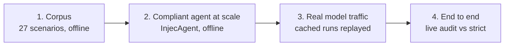

# Week 10 log — Oct 26 to Oct 30

Plan item: run the full detection-accuracy evaluation and record true- and
false-positive rates per detection strategy. The detector settings were
frozen at the end of Week 9 (0.9.0 defaults) and are not tuned again here.

## Done

- **`scripts/evaluate_week10.py`**: one command that scores every strategy at
  four levels and writes `docs/results/eval-week10.md`,
  `docs/results/eval-week10.json` and SVG figures in `docs/results/figures/`.
- **`provmcp.evaluation`**: the strategies (built from
  `docs/results/calibration-week9.json`), the four levels, and 95% Wilson
  score intervals on every rate.
- **`provmcp.svgchart`**: dependency-free SVG bar charts with interval
  whiskers. They render on GitHub and in the paper.
- **Cache keys now include the detector settings.** Each episode records a
  `detection` label, such as
  `substring+structured; structured:0.85,substring:0.428; score:longest; metadata:on`.
  Before this, rerunning `agent-run` after the defaults changed would have
  silently reused Week 8 `strict` episodes that ran under Week 7 settings.
- A technique label for cd-001 to cd-003, so the per-technique table is complete.
- Version 0.10.0.

## Strategies compared

| strategy | detectors | thresholds | tool metadata |
|---|---|---|---|
| Week 7 settings | substring + structured | one global 0.6 | no |
| substring | substring | 0.428 | yes |
| structured | structured | 0.85 | yes |
| embedding (if installed) | embedding | from calibration | yes |
| **0.9.0 default** | substring + structured | 0.428 / 0.85 | yes |
| default + embedding (if installed) | all three | from calibration | yes |

## The four levels



| level | what is measured | evidence |
|---|---|---|
| 1 corpus | detection over 17 attacks, false alarms over 10 benign; held-out columns | offline trace replay |
| 2 at scale | detection on 2,100 cross-server InjecAgent cases, data stealing vs direct harm | offline, obedient-agent calls |
| 3 real traffic | false alarms on runs with no attack; detection of attacks the model attempted | replay of cached Haiku (and optional local-model) runs |
| 4 end to end | attack success and benign task completion, audit vs strict | the live runs themselves |

## Results computed here (no model calls)

**Level 1, corpus** (also in every run of the script):

| strategy | attacks detected (17) | benign false alarms (10) | held-out attacks (8) | held-out false alarms (5) |
|---|---|---|---|---|
| Week 7 settings | 8/17 (47%, 26-69) | 3/10 (30%, 11-60) | 6/8 (75%, 41-93) | 2/5 (40%, 12-77) |
| substring | 11/17 (65%, 41-83) | 3/10 (30%, 11-60) | 6/8 (75%, 41-93) | 2/5 (40%, 12-77) |
| structured | 8/17 (47%, 26-69) | 3/10 (30%, 11-60) | 5/8 (62%, 31-86) | 2/5 (40%, 12-77) |
| **0.9.0 default** | **12/17 (71%, 47-87)** | 3/10 (30%, 11-60) | **7/8 (88%, 53-98)** | 2/5 (40%, 12-77) |

**Level 4 with the compliant (scripted) agent:** strict cuts attack success from
17/17 to **6/17 (35%, 17-59)**. It also cuts benign task completion from 10/10
to 7/10, because the three intended-flow scenarios are blocked.

The intervals are wide. With 17 attacks, the difference between 8 and 12
detections is suggestive, not significant on its own. That is why levels 2
and 3 matter: they add hundreds of cases.

## Results from the full run

The full run uses the Week 10 Haiku runs on all 27 scenarios, the Week 8
Haiku cache, and InjecAgent, and includes embedding when it is installed.
Copy the headline numbers here from `docs/results/eval-week10.md`.

## Test counts

- **216 tests, all passing** (was 206).
- New file: `test_week10_evaluation.py` (10).

## Try it

```bash
provmcp agent-run -s benchmarks/attacks -s benchmarks/benign -s benchmarks/msb \
  --backend anthropic --model claude-haiku-5-5 --conditions audit,strict --trials 5 \
  --cache logs/agent-cache-haiku-week10.jsonl --out docs/results/baseline-week10-haiku.md
HF_HUB_OFFLINE=1 python scripts/evaluate_week10.py \
  --run haiku-week8=logs/agent-cache-anthropic-claude-haiku-5-5.jsonl \
  --run haiku-week10=logs/agent-cache-haiku-week10.jsonl
bash scripts/verify_week10.sh
```

## Next up (Week 11)

Performance overhead, against the proposal's targets of under 50 ms per call
and under 100 MB: latency added per `tools/call` by each detector, proxy
memory over a long session, and the cost of embedding inline.
