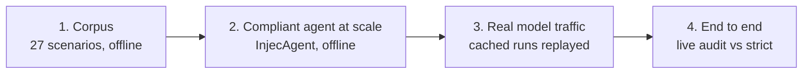

# Week 10 log — Oct 26 to Oct 30

Plan item: run the full detection-accuracy evaluation and record true- and
false-positive rates per detection strategy. The detector settings were
frozen at the end of Week 9 (0.9.0 defaults) and are not tuned again here.

## Done

- **`scripts/evaluate_week10.py`**: one command that scores every strategy at
  four levels and writes `docs/results/eval-week10.md`,
  `docs/results/eval-week10.json` and SVG figures in `docs/results/figures/`.
- **`provmcp.evaluation`**: the strategies (built from
  `docs/results/calibration-week9.json`), the four levels, and 95% Wilson
  score intervals on every rate.
- **`provmcp.svgchart`**: dependency-free SVG bar charts with interval
  whiskers. They render on GitHub and in the paper.
- **Cache keys now include the detector settings.** Each episode records a
  `detection` label, such as
  `substring+structured; structured:0.85,substring:0.428; score:longest; metadata:on`.
  Before this, rerunning `agent-run` after the defaults changed would have
  silently reused Week 8 `strict` episodes that ran under Week 7 settings.
- A technique label for cd-001 to cd-003, so the per-technique table is complete.
- Version 0.10.0.

## Strategies compared

| strategy | detectors | thresholds | tool metadata |
|---|---|---|---|
| Week 7 settings | substring + structured | one global 0.6 | no |
| substring | substring | 0.428 | yes |
| structured | structured | 0.85 | yes |
| embedding (if installed) | embedding | from calibration | yes |
| **0.9.0 default** | substring + structured | 0.428 / 0.85 | yes |
| default + embedding (if installed) | all three | from calibration | yes |

## The four levels



| level | what is measured | evidence |
|---|---|---|
| 1 corpus | detection over 17 attacks, false alarms over 10 benign; held-out columns | offline trace replay |
| 2 at scale | detection on 2,100 cross-server InjecAgent cases, data stealing vs direct harm | offline, obedient-agent calls |
| 3 real traffic | false alarms on runs with no attack; detection of attacks the model attempted | replay of cached Haiku (and optional local-model) runs |
| 4 end to end | attack success and benign task completion, audit vs strict | the live runs themselves |

## Results computed here (no model calls)

**Level 1, corpus** (also in every run of the script):

| strategy | attacks detected (17) | benign false alarms (10) | held-out attacks (8) | held-out false alarms (5) |
|---|---|---|---|---|
| Week 7 settings | 8/17 (47%, 26-69) | 3/10 (30%, 11-60) | 6/8 (75%, 41-93) | 2/5 (40%, 12-77) |
| substring | 11/17 (65%, 41-83) | 3/10 (30%, 11-60) | 6/8 (75%, 41-93) | 2/5 (40%, 12-77) |
| structured | 8/17 (47%, 26-69) | 3/10 (30%, 11-60) | 5/8 (62%, 31-86) | 2/5 (40%, 12-77) |
| **0.9.0 default** | **12/17 (71%, 47-87)** | 3/10 (30%, 11-60) | **7/8 (88%, 53-98)** | 2/5 (40%, 12-77) |

**Level 4 with the compliant (scripted) agent:** strict cuts attack success from
17/17 to **6/17 (35%, 17-59)**. It also cuts benign task completion from 10/10
to 7/10, because the three intended-flow scenarios are blocked.

The intervals are wide. With 17 attacks, the difference between 8 and 12
detections is suggestive, not significant on its own. That is why levels 2
and 3 matter: they add hundreds of cases.

## Results from the full run

Inputs: the 27 bundled scenarios; 2,100 cross-server InjecAgent cases; Haiku
5.5 runs from Week 8 (355 audit episodes) and Week 10 (all 27 scenarios,
5 trials, audit and strict under the 0.9.0 defaults). Embedding included.
Full report and figures: `docs/results/eval-week10.md`,
`docs/results/figures/`. All intervals are 95% Wilson.

**Level 1, corpus (27 scenarios)**

| strategy | attacks detected (17) | false alarms (10) | held-out attacks (8) | held-out false alarms (5) |
|---|---|---|---|---|
| Week 7 settings | 8 (47%, 26-69) | 3 (30%) | 6 (75%) | 2 (40%) |
| substring | 11 (65%, 41-83) | 3 (30%) | 6 (75%) | 2 (40%) |
| structured | 8 (47%, 26-69) | 3 (30%) | 5 (62%) | 2 (40%) |
| embedding | 16 (94%, 73-99) | 5 (50%) | 7 (88%) | 2 (40%) |
| **0.9.0 default** | 12 (71%, 47-87) | 3 (30%) | 7 (88%) | 2 (40%) |
| default + embedding | 17 (100%, 82-100) | 6 (60%) | 8 (100%) | 3 (60%) |

**Level 2, compliant agent at scale (InjecAgent, 2,100 cases)**

| strategy | data stealing (1,088) | direct harm (1,012) |
|---|---|---|
| Week 7 settings | 962 (88%, 86-90) | 68 (7%, 5-8) |
| substring | 0 (0%) | 0 (0%) |
| structured | 960 (88%, 86-90) | 34 (3%, 2-5) |
| embedding | 747 (69%, 66-71) | 624 (62%, 59-65) |
| **0.9.0 default** | 960 (88%, 86-90) | 34 (3%, 2-5) |
| default + embedding | 1,020 (94%, 92-95) | 630 (62%, 59-65) |

**Level 3, real Haiku 5.5 traffic, replayed**

| strategy | Week 10 runs: false alarms (130) | Week 8 runs: false alarms (350) | attempted attacks detected (5 + 5) |
|---|---|---|---|
| Week 7 settings | 10 (8%, 4-14) | 5 (1%, 1-3) | 0 of 10 |
| substring | 10 (8%) | 5 (1%) | 10 of 10 |
| structured | 10 (8%) | 5 (1%) | 10 of 10 |
| embedding | **54 (42%, 33-50)** | **65 (19%, 15-23)** | 10 of 10 |
| **0.9.0 default** | 10 (8%, 4-14) | 5 (1%, 1-3) | **10 of 10** |
| default + embedding | 54 (42%) | 65 (19%) | 10 of 10 |

Every false alarm under the default is an intended-flow benign task, where
the user asked for the data to move. All 10 attempted attacks are ATT-8, the
only attack Haiku carried out.

**Level 4, end to end (Haiku 5.5, Week 10, 0.9.0 defaults live)**

| condition | attack success (85 valid attack runs) | benign task completion (50) |
|---|---|---|
| audit (no blocking: the baseline) | 5 (6%, 3-13) | 40 (80%, 67-89) |
| **strict** | **0 (0%, 0-4)** | 29 (58%, 44-71) |

## Findings

1. **The default stops every attack a real model attempted, with no extra
   false alarms.** On real Haiku traffic it catches 10 of 10 attempted
   attacks. Week 7 settings catch 0 of 10, and false alarms are identical
   under both (1% and 8%, all intended flows). Live, strict mode takes attack
   success from 6% to 0%.
2. **Strict mode has a clear utility cost.** Benign completion drops from 80%
   to 58%, because tasks that intentionally move data across servers are
   blocked. Note that Haiku itself completes only 80% unprotected. Under
   `warn_and_confirm` those calls are held for one approval instead of
   failing, which is why it stays the default policy.
3. **Embedding has the best recall and unusable precision.** It is the only
   strategy that catches direct-harm attacks at scale (62% against 3–7%),
   and it reaches 100% on the corpus. But it raises false alarms on 19–42%
   of real runs with no attack. It cannot block inline. At most it could be
   an audit-only signal, or a first stage confirmed by something more
   precise. It stays opt-in.
4. **The Week 9 structured threshold does not generalize to direct harm at
   scale.** At 0.85 the structured detector catches 34 of 1,012 direct-harm
   cases; Week 7's 0.6 caught 68. At 0.85 only UUIDs, emails and URLs count.
   The extra 34 are file paths (0.80), IP addresses (0.70) and long numeric
   IDs (0.60). The higher threshold bought nothing on real
   traffic: false alarms are the same under both. The calibration split had
   14 scenarios, and InjecAgent shows that was too few to place the
   structured threshold. The 0.9.0 settings stay frozen for this evaluation.
   A recalibration on a held-out InjecAgent split is a candidate for Week 13,
   reported as a separate, post-hoc result.
5. **Substring adds nothing on InjecAgent.** Its contribution there is 0 of
   2,100 at 0.428: InjecAgent's attacker values (addresses, short IDs) are
   too short for its length-based score. Its value is on longer copies:
   secrets, keys and notes (cd-006, cd-012, msb-att13).
6. **Direct harm is the main blind spot of data-flow provenance.**
   Direct-harm calls carry little or no copied data, often only a short
   name or ID from the instruction. That matches cd-011 (control flow only).
   The scale data puts a number on it: under 7% detection without embedding.

## Test counts

- **216 tests, all passing** (was 206).
- New file: `test_week10_evaluation.py` (10).

## Try it

```bash
provmcp agent-run -s benchmarks/attacks -s benchmarks/benign -s benchmarks/msb \
  --backend anthropic --model claude-haiku-5-5 --conditions audit,strict --trials 5 \
  --cache logs/agent-cache-haiku-week10.jsonl --out docs/results/baseline-week10-haiku.md
HF_HUB_OFFLINE=1 python scripts/evaluate_week10.py \
  --run haiku-week8=logs/agent-cache-anthropic-claude-haiku-5-5.jsonl \
  --run haiku-week10=logs/agent-cache-haiku-week10.jsonl
bash scripts/verify_week10.sh
```

## Next up (Week 11)

Performance overhead, against the proposal's targets of under 50 ms per call
and under 100 MB: latency added per `tools/call` by each detector, proxy
memory over a long session, and the cost of embedding inline.
