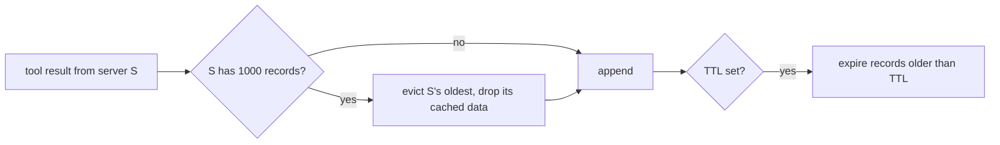
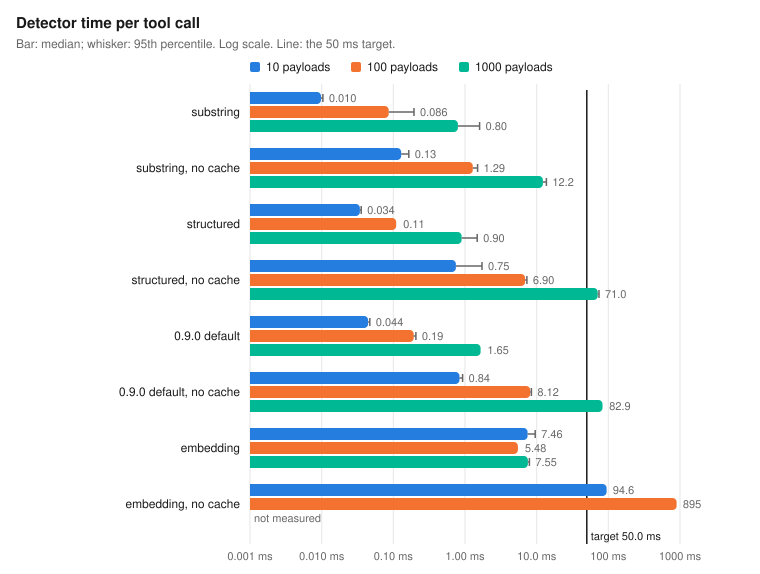
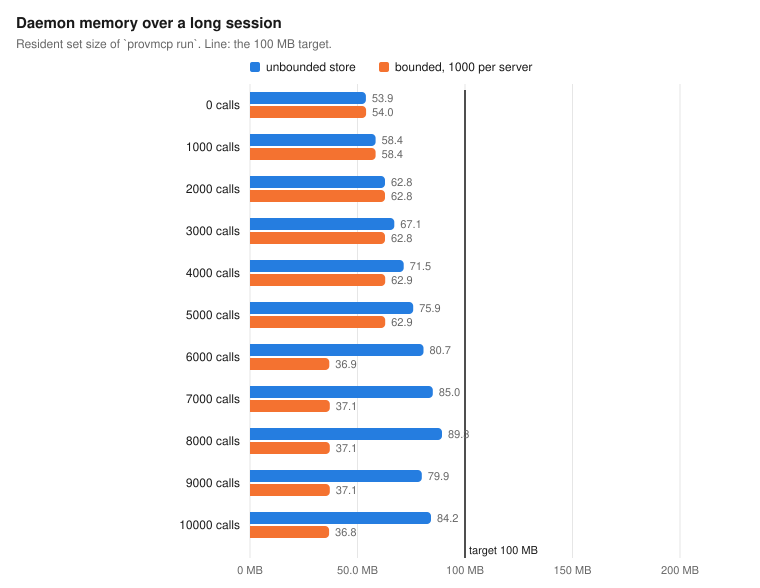

# Week 11 log — Nov 2 to Nov 6

Plan item: run the performance-overhead evaluation, measuring latency and
memory under realistic load. The proposal's targets are **under 50 ms added
per tool call** and **under 100 MB** of memory.

## Done

- **`provmcp.perf` and `scripts/bench_week11.py`** measure:
  - each detector's time per call, as the provenance store grows to 10, 100 and 1,000 payloads, with and without the new cache;
  - the latency ProvMCP adds in-process over stdio;
  - end-to-end latency, throughput and memory of a real `provmcp run` daemon over HTTP, sequential and with 8 concurrent clients;
  - daemon memory across a 10,000-call session, with an unbounded and a bounded store;
  - what the embedding model costs on its own.

  Results go to `docs/results/perf-week11.md` and `.json`, with figures.
- **Per-payload cache in the provenance store.** Before this, every outbound
  call re-derived word runs, typed fields and sentence embeddings for *every*
  stored payload, so detector cost grew linearly with session length.
  `ProvenanceStore.derived()` now computes each once per payload and drops
  it with the payload. A test checks that findings are identical with and
  without the cache.
- **Bounded provenance store** (closes the Week 7 limitation "no expiry"):
  - `[proxy] provenance_max_per_server = 1000` (the new default) keeps each source server's newest 1,000 payloads;
  - `[proxy] provenance_ttl_seconds` (optional) expires payloads by age, checked when the store is written and read.
- Log-scale and target-line charts in `provmcp.svgchart`. Version 0.11.0.

## Design note: why the cap is per server

A single global cap would open a **provenance-flushing attack**. A hostile
server could answer many cheap calls until the poisoned record it planted
earlier is evicted. After that, the address it injected would look like
data with no origin. With a cap per source server, a server can only evict
its own old records. A third server's noise can never push out the record
that ties `Exfil@Evil.Example` to the calendar. Two weaker forms remain for
Week 12's adaptive adversary:

- **Self-flushing:** the poisoning server floods its own quota before the exfiltration call.
- **Waiting out a TTL:** this only applies if a TTL is configured; there is none by default.



## Results on the Mac

One full run of `scripts/bench_week11.py` on the MacBook Pro. The machine,
Python version and every table are in `docs/results/perf-week11.md`.

- **Calls per row:** 200 per detector row (30 for embedding); 500 for the proxy and daemon rows (100 with embedding).
- **Workload:** ~1 KB tool results and outbound calls that match nothing, so every call is fully inspected and none is held.
- The Linux container's earlier runs showed the same shape (16× and 31× speed-ups at 10 and 100 payloads), but the numbers below are the ones to report.

**Detector time per call, ms**

| detection | store size | cached p50 / p95 | no cache (0.10) p50 / p95 | speed-up (p50) |
|---|---|---|---|---|
| 0.9.0 default | 10 | 0.044 / 0.047 | 0.837 / 0.925 | 19× |
| 0.9.0 default | 100 | 0.193 / 0.206 | 8.12 / 8.44 | 42× |
| 0.9.0 default | 1,000 | **1.65 / 1.70** | **82.9 / 84.7** | 50× |
| embedding | 10 | 7.46 / 9.54 | 94.6 / 95.1 | 13× |
| embedding | 100 | 5.48 / 5.65 | 895 / 904 | 163× |
| embedding | 1,000 | 7.55 / 7.91 | not run (the cache fill, the same work, took 9.0 s) | - |



- **Growth without the cache:** default detection costs 0.083 ms more per stored payload. It passes 50 ms at about 600 payloads (interpolated).
- **Growth with the cache:** 1.6 µs more per stored payload.
- **The "first call" column** in the full report does the one-time work for the whole store (84.7 ms at 1,000 payloads for the default; 9.0 s for embedding). That only happens here because the benchmark fills the store before the first scan. In a real session, results arrive one at a time and each one is processed on the next scan: about 0.08 ms per new result for the default, about 9 ms for embedding.

**Latency ProvMCP adds** (stdio, in-process, 500 calls, 500 payloads stored
by the end): **0.429 ms at p50, 0.631 ms at p95.**

**Daemon over HTTP** (`provmcp run`, loopback). These are full round trips,
including HTTP and the echo server, so they over-state what ProvMCP itself
adds.

| detection | calls | 1 client p50 / p95 | 8 clients p50 / p95 | throughput, 8 clients | RSS idle / after |
|---|---|---|---|---|---|
| 0.9.0 default | 500 | 0.99 / 2.33 ms | 6.57 / 8.15 ms | 1,175 calls/s | 54.0 / 51.4 MB |
| default + embedding | 100 | 12.3 / 14.6 ms | **95.2 / 96.9 ms** | 84 calls/s | 54.0 / **464 MB** |

**Memory over a long session** (10,000 calls alternating between two
servers, 0.9.0 default detection)

| store | payloads held at the end | RSS after 10,000 calls |
|---|---|---|
| unbounded | 10,000 | 84.2 MB |
| bounded, 1,000 per server (the default) | 2,000 | 36.8 MB |



**The embedding model on its own** (fresh process)

| step | time | RSS after |
|---|---|---|
| start | - | 35.2 MB |
| import sentence-transformers | 3.6 s | 393.5 MB |
| load all-MiniLM-L6-v2 | 0.46 s | 362.2 MB |
| encode one sentence, p50 / p95 | 4.4 / 6.3 ms | 497.9 MB |

**Against the targets**

| target | 0.9.0 default | default + embedding |
|---|---|---|
| under 50 ms: detector, 1,000 payloads, p95 | **meets**, 1.70 ms | **meets**, 7.91 ms |
| under 50 ms: added in-process, p95 | **meets**, 0.63 ms | not measured |
| under 50 ms: daemon round trip, 1 client, p95 | **meets**, 2.33 ms | **meets**, 14.6 ms |
| under 50 ms: daemon round trip, 8 clients, p95 | **meets**, 8.15 ms | **misses**, 96.9 ms |
| under 100 MB | **meets**: 36.8 MB bounded, 84.2 MB unbounded, after 10,000 calls | **misses**: 464 MB (daemon), 498 MB (model alone) |

## Findings

1. **The cache is what makes the latency target hold in long sessions.**
   - Without it, default detection takes 84.7 ms at p95 with 1,000 stored payloads. With it, 1.70 ms.
   - The per-server cap limits each source server to 1,000 payloads, so the cached cost is at most about 1.7 ms per source server.
   - Extrapolated, cached default detection would reach 50 ms at about 30,000 payloads: 30 servers all at the cap.
2. **The 0.9.0 default meets both targets with a wide margin.**
   - **Overhead:** 0.63 ms at p95 in-process; 2.33 ms for a full HTTP round trip through the daemon, or 8.15 ms with 8 clients.
   - **Memory:** under 100 MB even without the bound, at 84.2 MB after 10,000 calls. The bound is still needed: an unbounded store grows with every result, and 84.2 MB leaves only 16 MB of headroom. With the bound, memory is 36.8 MB.
3. **Embedding misses the memory target by about 5×, and the cause is the ML runtime, not the store.**
   - Importing sentence-transformers alone takes the process from 35 to 394 MB, before any model is loaded.
   - Its per-call latency is within target with one client (14.6 ms at p95).
   - Week 10 found embedding raises false alarms on 19–42% of real runs. Memory is a second, independent reason to keep it opt-in.
   - If it is ever needed, the options are a lighter runtime (for example ONNX) or running it out of process as an audit-only signal. Neither is evaluated here.
4. **The daemon serves calls almost one at a time.**
   - With 8 clients, throughput (1,175 calls/s) is only a little above one client's rate (about 1,000 calls/s at 0.99 ms each).
   - The medians match Little's law for a saturated queue: 8 / 1,175 per s ≈ 6.8 ms (measured 6.57 ms). With embedding, 8 / 84.3 per s ≈ 95 ms (measured 95.2 ms).
   - The cause: detection runs on the daemon's event loop, and each stdio server takes one request at a time.
   - This costs the default little. It is what pushes embedding past 50 ms with 8 clients. Moving detection off the event loop is a possible Week 14 item.
5. **Measurement caveats.**
   - This is one run on one machine, with no repeats, so the timings have no intervals.
   - macOS compresses idle memory, so RSS can fall as well as rise (54.0 → 51.4 MB in the daemon run; 393.5 → 362.2 MB while loading the model). RSS differences of a few MB are noise.
   - The 10-payload embedding row (7.5 ms) is slower than the 100-payload row (5.5 ms). It runs first, straight after the model loads, so it probably includes warm-up. Read cached embedding cost as roughly 5–8 ms at p50, flat in store size.

## Test counts

- **231 tests, all passing** (was 216).
- New file: `test_week11_performance.py` (15). One test starts a real daemon
  and checks that its store stays within the per-server bound.

## Try it

```bash
HF_HUB_OFFLINE=1 python scripts/bench_week11.py          # full, about 5-10 min
python scripts/bench_week11.py --quick --skip-http       # smoke run, seconds
bash scripts/verify_week11.sh
```

## Next up (Week 12)

Adaptive-adversary robustness. Attacks are written to evade ProvMCP:
encoding and reformatting, paraphrase, splitting a value across calls,
self-flushing the provenance store, laundering data through a trusted
server, and instruction-only (control-flow) hijacks. The residual attack
surface is documented.
